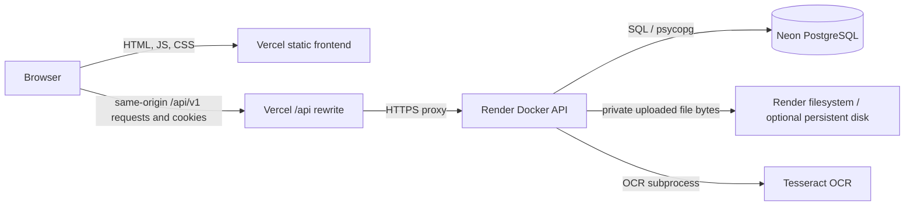
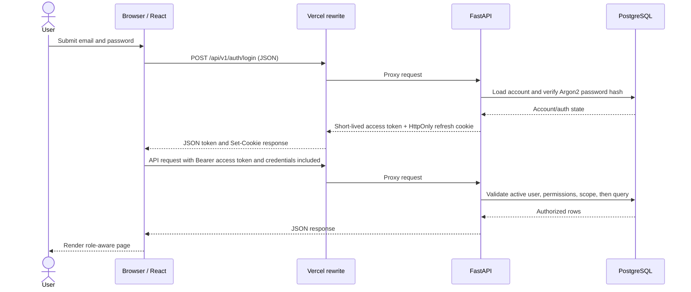
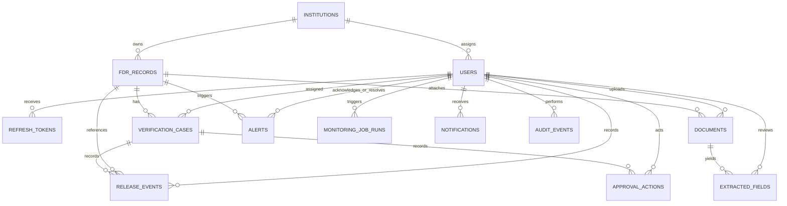

# FDR Guardian — Technical Document

> **Project status and scope:** FDR Guardian is a synthetic-data demonstration application developed in a Smart India Hackathon context. It contains no AICTE data and has no connection or integration to AICTE or any government system. Nothing in this document or repository is a claim of production readiness, official status, regulatory compliance, or suitability for real financial records.

## Table of contents

1. [Project overview](#1-project-overview)
2. [Key features](#2-key-features)
3. [System architecture](#3-system-architecture)
4. [Technology stack](#4-technology-stack)
5. [Repository structure](#5-repository-structure)
6. [Database design](#6-database-design)
7. [Backend API reference](#7-backend-api-reference)
8. [Authentication and authorization](#8-authentication-and-authorization)
9. [Core business logic](#9-core-business-logic)
10. [Document processing](#10-document-processing)
11. [Frontend](#11-frontend)
12. [Seed and demo data](#12-seed-and-demo-data)
13. [Configuration](#13-configuration)
14. [Deployment](#14-deployment)
15. [Security measures and known gaps](#15-security-measures-and-known-gaps)
16. [Testing](#16-testing)
17. [Limitations and future scope](#17-limitations-and-future-scope)
18. [Appendix](#18-appendix)
19. [Verification notes](#verification-notes)

## 1. Project overview

### For SIH evaluators

FDR Guardian demonstrates a web-based workflow for registering institutions and fixed deposit receipt (FDR) records, viewing maturity-related summaries and alerts, and attaching documents for machine-assisted field extraction. Demo records are synthetic and labelled as such. The maturity rules and thresholds are demonstration rules, not verified AICTE policy.

### For developers

The project is a React/Vite single-page frontend and a FastAPI JSON API backed by PostgreSQL using SQLAlchemy and Alembic. The backend enforces bearer-token authentication and role permissions, applies institution scoping to relevant reads and writes, writes audit events for selected mutations, stores validated documents in a private filesystem directory, and runs OCR/text-layer extraction asynchronously in process.

### Objective and boundaries

The objective represented by the implemented code is to demonstrate an FDR registry, role-aware views, summary/reporting endpoints, maturity monitoring, and document upload/extraction. The application does not connect to an official institution registry, banks, AICTE, or government identity systems. There is no implemented live banking verification or payment/release integration. A persisted `ReleaseEvent` represents an explicit demo record; it does not move funds or contact a bank.

Case, approval-action, and release-event tables and synthetic scenarios exist in the schema/seed data, but the repository does not implement dedicated verification-case or approval workflow API routes or frontend pages. This distinction matters: persisted sample workflow rows and dashboard counts are not evidence of an end-to-end case-management feature.

## 2. Key features

### Institution registry

- Paginated, searchable institution listing with state and status filters and sorting.
- Institution detail with counts, active FDR count, principal total, and nearest upcoming maturity date.
- Create and update institution endpoints for permitted roles.
- Institution administrators are scoped to their assigned institution.

### FDR registry

- Create, list, view, edit, filter, sort, and search FDR records.
- Optimistic update check using `updated_at` to reject stale edits.
- Explicit allowed record-status transitions with required remarks.
- History timeline for FDR creation, edits, and status changes.
- Server-side filtering by institution, record status, verification status, maturity period, and search term.

### Dashboard and reports

- Dashboard totals and chart series for statuses, maturities, institutions, and verification-case statuses.
- Institution summary and maturity reports with JSON pagination and CSV export for roles granted export permission.
- Maturity-date buckets use configurable demo thresholds.

### Alerts and monitoring

- Maturity-band rule evaluation with open/acknowledged alert lifecycle maintenance.
- Alert listing, details/history, acknowledgement, and manual resolution with remarks.
- Monitoring summaries, rule viewing/configuration, run history, and manual run.
- Optional in-process daily scheduler; disabled by default.

### Document upload and extraction

- Accepts validated PDF, PNG, and JPEG files with extension/content agreement, byte and page limits, duplicate checksum detection, and a per-FDR document limit.
- Private local filesystem storage and authorized download.
- PDF text-layer extraction when text exists; otherwise OCR via Tesseract, including image inputs.
- Extracted-field values expose method, confidence when available, source page, stored FDR value, and a comparison state.
- Missing stored files return a safe `410` message and set a safe processing error code.
- Extraction is advisory; the response explicitly states that machine extraction does not confirm document genuineness.

### Authentication, permissions, and audit

- Login, access-token refresh, logout, and current-user profile endpoints.
- Permission enforcement in backend dependencies and role-filtered navigation in the frontend.
- Audit events are written for selected operations, including FDR changes, document actions, report CSV exports, authentication events, monitoring runs, and user administration.

## 3. System architecture

The deployment guide describes Vercel for the frontend, an external rewrite to Render for `/api/*`, Neon PostgreSQL for backend state, Tesseract OCR in the backend container, and local private filesystem storage. The checked-in `frontend/vercel.json` contains the backend hostname in its rewrite. A real deployment and live service operation are **Not verified in repository**.



### Request flow: login and authenticated API use



The frontend defaults to relative `/api/v1`; this keeps browser requests on the Vercel origin while Vercel proxies them. The refresh cookie is sent with credentialed fetch requests. Direct cross-origin backend use is possible only if the configured CORS origin and cookie policy support it; that is not the documented deployment path.

## 4. Technology stack

Versions below are taken from `backend/requirements*.txt`, `frontend/package.json`, and `frontend/package-lock.json`. Backend requirements specify version ranges rather than a fully locked resolved environment; exact installed backend versions are **Not verified in repository**. Frontend lockfile versions are exact resolutions for the checked-in lockfile.

### Backend

| Package / technology | Declared version | Use in repository |
| --- | --- | --- |
| Python | `3.12` Docker base (`python:3.12-slim-bookworm`) | Backend runtime |
| FastAPI | `>=0.115,<1.0` | API routing, request validation, OpenAPI outside production |
| Uvicorn | `>=0.34,<1.0` | ASGI server |
| SQLAlchemy | `>=2.0,<3.0` | ORM and PostgreSQL queries |
| psycopg 3 | `psycopg[binary]>=3.2,<4.0` | PostgreSQL driver; generic PostgreSQL URLs are converted to `postgresql+psycopg` |
| Alembic | `>=1.13,<2.0` | Versioned schema migrations |
| python-dotenv | `>=1.0,<2.0` | Local `.env` loading |
| PyJWT | `>=2.10,<3.0` | HS256 access-token encoding/decoding |
| argon2-cffi | `>=23.1,<26.0` | Password hashing and verification |
| APScheduler | `>=3.11,<4.0` | Optional in-process daily scheduler |
| python-multipart | `>=0.0.20,<1.0` | Multipart document upload parsing |
| Pillow | `>=11.0,<14.0` | Image validation and OCR image handling |
| pytesseract | `>=0.3.13,<1.0` | Python bridge to Tesseract |
| pypdfium2 | `>=4.30,<6.0` | PDF validation, text extraction, and rasterization |
| tzdata | `>=2025.1` | Time-zone database support |
| pytest | `>=8.3,<9.0` (runtime requirements) | Backend tests |
| httpx | `>=0.28,<1.0` | FastAPI TestClient transport |
| reportlab | `>=4.2,<6.0` (dev requirements) | Synthetic PDF fixtures |

Tesseract itself is installed by the Dockerfile as `tesseract-ocr` with English language data (`tesseract-ocr-eng`).

### Frontend

| Package / technology | Version from package files | Use in repository |
| --- | --- | --- |
| React / React DOM | `^19.1.1`; lockfile `19.3.1` | Component UI and rendering |
| TypeScript | `~5.9.2`; lockfile `5.9.3` | Static type checking; `tsc -b` is part of build |
| Vite | `^7.1.7`; lockfile `7.3.7` | Dev server and production bundling |
| React Router DOM | `^7.18.4`; lockfile `7.18.4` | SPA route navigation |
| Tailwind CSS | `^4.1.14`; lockfile `4.3.3` with `@tailwindcss/vite` | Utility styling |
| Vitest | `^5.0.5`; lockfile `5.0.5` | Frontend unit/component tests |
| Testing Library React / jest-dom | `^16.3.3` / `^7.0.1`; same lockfile versions | DOM interaction and assertions |
| Recharts | `^3.10.1`; lockfile `3.10.1` | Dashboard charts |
| React Hook Form / Zod resolver / Zod | `^7.91.0` / `^6.0.0` / `^4.6.7`; same lockfile versions | Form state and validation |
| lucide-react | `^1.61.0`; lockfile `1.61.0` | UI line icons |
| Base UI React | `^1.9.0`; lockfile `1.9.0` | Accessible UI primitives |
| Tailwind Vite plugin / Vite React plugin | `^4.1.14` / `^5.0.4`; lockfile `4.3.3` / `5.2.0` | Build-time CSS and React support |
| Geist font / class-variance-authority / `cn` | `^5.3.0` / `^0.7.1` / `^0.5.0` | Bundled typeface and UI class composition |
| jsdom / shadcn | `^30.1.3` / `^4.22.1` | Test DOM and UI component tooling |

The frontend lockfile captures exact resolutions; run `npm ci` in `frontend` to install that graph. Python package ranges are not an exact lock; exact resolved backend versions are **Not verified in repository**.

## 5. Repository structure

```text
backend/
├── app/
│   ├── api/              FastAPI route modules and auth dependencies
│   ├── core/             Environment configuration, permissions, token/password security
│   ├── db/               Engine/session, demo seed and password utility commands
│   ├── models/           SQLAlchemy models and constrained enums
│   ├── schemas/          Pydantic request/response schemas
│   ├── services/         Audit, institution scope, OCR/storage, maturity monitoring
│   ├── main.py           App factory, middleware, CORS, lifespan
│   └── seed.py           Deterministic synthetic fixture dataset
├── migrations/versions/  Alembic migration scripts
├── scripts/              OCR synthetic fixture generation/evaluation scripts
├── tests/                Backend API, service, config, migration and seed tests
├── Dockerfile            Python/Tesseract production container definition
├── start.sh              Validates settings, migrates, then starts Uvicorn
├── requirements*.txt     Runtime and development Python dependency ranges
└── alembic.ini           Alembic configuration

frontend/
├── src/auth/             Auth context and protected-route behavior
├── src/components/       Shared shell, document UI, branding and UI primitives
├── src/config/           API URL and branding environment configuration
├── src/pages/            Login, dashboard, registry, reports, alerts pages
├── src/lib/              Registry formatting and request helpers
├── src/styles.css        Global/theme styles
├── public/               Static assets
├── package.json          Frontend scripts and dependency ranges
├── package-lock.json     Exact npm dependency resolution
└── vercel.json           API proxy rewrite and SPA fallback

docs/                     Phase implementation notes and deployment/project guides
```

## 6. Database design

All tables below are declared in SQLAlchemy models and represented in the Alembic chain. Every model inherits a UUID primary key named `id`; models using `TimestampMixin` also have server-created `created_at` and `updated_at` timestamps. `RESTRICT` foreign keys intentionally prevent deletion while referenced rows remain.

### Tables and columns

`?` marks nullable columns. Unless stated, columns are non-null. Types are described in PostgreSQL/SQLAlchemy terms; UUID primary keys are implicit in each row below.

| Table | Columns (excluding `id`) |
| --- | --- |
| `institutions` | `institution_code` varchar(32), `institution_name` varchar(200), `institution_type?` varchar(80), `state?` varchar(80), `contact_email?` varchar(254), `status` varchar(24), `is_synthetic` boolean, `created_at`, `updated_at` |
| `users` | `email` varchar(254), `full_name` varchar(160), `password_hash?` varchar(255), `role` varchar(32), `institution_id?` UUID, `is_active` boolean, `is_synthetic` boolean, `failed_login_attempts` integer, `locked_until?`, `last_login_at?`, `password_changed_at?`, `created_at`, `updated_at` |
| `refresh_tokens` | `user_id` UUID, `token_hash` varchar(64), `family_id` UUID, `expires_at`, `revoked_at?`, `replaced_by?` UUID, `created_at` |
| `fdr_records` | `institution_id` UUID, `internal_fdr_id` varchar(48), `external_record_id?` varchar(120), `bank_name` varchar(160), `branch_name?` varchar(160), `fdr_number` varchar(100), `amount` numeric(14,2), `currency` varchar(3), `issue_date`, `maturity_date`, `record_status` varchar(24), `verification_status` varchar(32), `source_system` varchar(64), `source_updated_at?`, `last_synced_at?`, `is_synthetic` boolean, `created_at`, `updated_at` |
| `documents` | `fdr_record_id` UUID, `document_type` varchar(32), `private_storage_key` varchar(500), `original_filename` varchar(255), `content_type` varchar(120), `file_size` integer, `checksum?` varchar(64), `uploaded_by` UUID, `uploaded_at`, `processing_status` varchar(24), `review_status` varchar(24), `processing_error_code?` varchar(40), `processing_started_at?`, `processed_at?`, `page_count?` integer, `ocr_engine?` varchar(120), `extraction_method?` varchar(32) |
| `extracted_fields` | `document_id` UUID, `field_name` varchar(80), `extracted_value?` text, `confidence_score?` numeric(4,3), `extraction_method` varchar(64), `source_page?` integer, `reviewer_confirmed_value?` text, `reviewed_by?` UUID, `reviewed_at?` |
| `verification_cases` | `fdr_record_id` UUID, `assigned_officer_id?` UUID, `status` varchar(32), `priority?` varchar(24), `reason` text, `opened_at`, `updated_at`, `closed_at?` |
| `approval_actions` | `case_id` UUID, `actor_id` UUID, `action_type` varchar(32), `decision` varchar(32), `from_status?` varchar(32), `to_status?` varchar(32), `remarks?` text, `created_at` |
| `release_events` | `case_id` UUID, `fdr_record_id` UUID, `recorded_by` UUID, `released_at`, `release_reference?` varchar(160), `remarks?` text, `is_demo` boolean |
| `alerts` | `fdr_record_id` UUID, `alert_type` varchar(64), `severity` varchar(16), `explanation` text, `status` varchar(24), `created_at`, `resolved_at?`, `resolved_by?` UUID, `rule_key?` varchar(80), `details` JSONB, `acknowledged_by?` UUID, `acknowledged_at?`, `resolution_type?` varchar(16), `resolution_remarks?` text, `reopened_at?`, `source` varchar(24), `last_evaluated_at?` |
| `maturity_rules` | `rule_key` varchar(80), `alert_type` varchar(64), `label` varchar(100), `min_days?` integer, `max_days?` integer, `severity` varchar(16), `is_active` boolean, `created_at`, `updated_at` |
| `monitoring_job_runs` | `job_name` varchar(80), `trigger` varchar(16), `reference_date`, `started_at`, `completed_at?`, `status` varchar(24), `records_evaluated` integer, `alerts_created` integer, `alerts_superseded` integer, `alerts_resolved` integer, `alerts_reopened` integer, `alerts_unchanged` integer, `errors_summary` JSONB, `triggered_by?` UUID |
| `notifications` | `recipient_user_id` UUID, `notification_type` varchar(32), `title` varchar(160), `message` text, `related_record_id?` UUID (not a declared FK), `read_at?`, `created_at` |
| `audit_events` | `actor_id?` UUID, `action` varchar(80), `entity_type` varchar(80), `entity_id` UUID (polymorphic; not a declared FK), `timestamp`, `correlation_id?` varchar(120), `change_summary` JSONB |
| `integration_sync_runs` | `source_name` varchar(120), `started_at`, `completed_at?`, `status` varchar(24), `records_read` integer, `records_created` integer, `records_updated` integer, `records_skipped` integer, `errors_summary` JSONB |

### Relationships



The diagram shows declared relational foreign keys. `notifications.related_record_id`, `audit_events.entity_id`, and `monitoring_rules`/alerts' `rule_key` are not declared foreign keys. A relationship absent from the database model is not implied by the conceptual diagram.

### Constraints and indexes

- `institutions.institution_code` and `users.email` are unique; `users.role` is enum-checked, and an `institution_admin` must have a non-null institution assignment.
- FDR amount must be positive and maturity must be after issue date. Record and verification statuses are constrained. `internal_fdr_id` is unique. A partial unique index protects non-null `(source_system, external_record_id)` pairs. Indexes cover FDR number, institution+FDR number, institution, maturity date, record status, and verification status.
- Documents constrain document/processing/review enum values; file size is non-negative, page count positive when present, and error code matches a safe lowercase underscore pattern. Storage key is unique; FDR has an index.
- Extracted values are unique per `(document_id, field_name)`; confidence is in `[0,1]`; source page is positive; extraction provenance is constrained to allowed methods. `document_id` is indexed.
- Verification-case status, approval action/decision/status values are enum-checked; case status and FDR references have indexes. Approval actions are indexed by case; release events by FDR.
- Alerts constrain status/severity, source, and resolution type. A partial unique index allows only one open/acknowledged alert per `(fdr_record_id, alert_type)`. FDR and status are indexed.
- Maturity rules require recognized severity, non-inverted bounds, and unique `rule_key`.
- Monitoring run trigger is one of `scheduled`, `manual`, or `cli`; runs indexed by `started_at`.
- Notification type is enum-checked and recipient indexed. Audit events indexed by `(entity_type, entity_id)` and timestamp. Integration sync status is enum-checked and its record counters are non-negative.

### Migration history

Alembic revision chain, oldest to newest:

1. `92c50da144bf` — `create_phase_2_data_schema` (root schema: institutions, FDR and related records, workflow/audit/integration structures).
2. `c05c691acd14` — `add authentication fields and refresh tokens` (user authentication fields and refresh-token persistence).
3. `5d6e7f8a9b10` — `add_maturity_monitoring` (maturity rule and monitoring tables, alert lifecycle fields/status constraints).
4. `6a7b8c9d0e12` — `secure_documents_ocr` (private document processing and extraction metadata/provenance, status/type data migration).

## 7. Backend API reference

All application endpoints use the `/api/v1` prefix. Unless marked public, a valid `Authorization: Bearer <access-token>` is required. Role access is expressed by backend permission names in [section 8](#8-authentication-and-authorization). JSON shapes below are compact summaries of the Pydantic schemas and route implementations; error responses generally use `{"detail": "..."}`. Query parameters omitted from a row are not accepted by that route.

| Method and path | Auth / permission | Request | Response / purpose |
| --- | --- | --- | --- |
| `GET /health` | Public | None | `{"status":"ok","service":"fdr-guardian-api"}`. Process health only. |
| `GET /health/database` | Public | None | `{"status":"connected"\|"unavailable"\|"not_configured"}`; safe database connectivity check. |
| `POST /auth/login` | Public | `{email,password}` | `{access_token,token_type}`; sets refresh cookie on success. Generic 401 on failed credentials. |
| `POST /auth/refresh` | Refresh cookie | Cookie `fdr_refresh` | `{access_token,token_type}`; rotates refresh token/cookie. |
| `POST /auth/logout` | Refresh cookie optional | Cookie `fdr_refresh` | `204`; revokes token when present and clears cookie. |
| `GET /auth/me` | Authenticated | None | `{id,email,full_name,role,institution_id,permissions}`. |
| `GET /admin/users` | `user.manage` | None | User array with identity, role, institution, active/synthetic flags, created time. |
| `POST /admin/users` | `user.manage` | `{email,full_name,role,institution_id?,is_active?}` | `201` user summary; creates a non-synthetic user without a password value in this request. |
| `PATCH /admin/users/{user_id}` | `user.manage` | Optional `{role?,institution_id?,is_active?}` | Updated user summary; logs role, institution, and deactivation events. |
| `GET /institutions` | `institution.read` | Paging; `q`, `status`, `state`, `sort_by`, `sort_order` | `{items,total,page,page_size}` of institution response fields. Institution admins see their assigned institution only. |
| `GET /institutions/{institution_id}` | `institution.read` | Path ID | Institution response plus `{stats:{total_fdrs,active_fdrs,total_principal_amount,nearest_upcoming_maturity_date}}`. |
| `POST /institutions` | `institution.write` | `{institution_code,institution_name,institution_type?,state?,contact_email?,status?}` | `201` institution response. |
| `PATCH /institutions/{institution_id}` | `institution.write` | Partial institution fields | Updated institution response. |
| `GET /fdrs` | `fdr.read` | Paging; institution/status/verification/maturity filters; `q`; sort | `{items,total,page,page_size}` with FDR response objects. |
| `GET /fdrs/{record_id}` | `fdr.read` | Path ID | FDR response: ID, institution, internal FDR ID, bank/branch, number, amount/currency/dates, statuses, source/synthetic flag and timestamps. |
| `POST /fdrs` | `fdr.write` | `{institution_id?,bank_name,branch_name?,fdr_number,amount,currency?,issue_date,maturity_date}` | `201` FDR response; institution assignment is enforced; starts `draft` / `not_submitted`. |
| `PATCH /fdrs/{record_id}` | `fdr.write` | `updated_at` plus editable FDR field(s) | Updated FDR response; returns conflict if stale. |
| `POST /fdrs/{record_id}/status` | `fdr.write` | `{record_status,remarks}` | Updated FDR response; only allowed transitions are accepted. |
| `GET /fdrs/{record_id}/history` | `fdr.read` | Path ID | Array `{action,actor_name,timestamp,changed_fields,remarks}` for supported FDR audit actions. |
| `GET /dashboard/summary` | `report.read` | None | Counts for institutions, FDRs, active records, upcoming/overdue-date maturities, pending cases, unresolved alerts. |
| `GET /dashboard/charts` | `report.read` | None | `{records_by_status,maturities_by_month,institution_distribution,cases_by_status}` count-point arrays. |
| `GET /reports/institution-summary` | `report.read`; CSV additionally `report.export` | Paging; `format=json\|csv` | JSON page of institution counts/principal/maturity; CSV response for export permission. |
| `GET /reports/maturities` | `report.read`; CSV additionally `report.export` | Date bounds, bucket, institution, paging, sort, `format=json\|csv` | JSON page of maturity rows/buckets or CSV. |
| `GET /alerts` | `alert.read` | Paging, severity/type/status/rule/institution/FDR/date/search/sort filters | `{items,total,page,page_size}` alert records plus FDR/institution summary. |
| `GET /alerts/{alert_id}` | `alert.read` | Path ID | Alert summary, safe details, resolution fields and lifecycle history. |
| `POST /alerts/{alert_id}/acknowledge` | `alert.manage` | None | Updated alert detail; only an open alert can be acknowledged. |
| `POST /alerts/{alert_id}/resolve` | `alert.manage` | `{remarks}` | Updated alert detail; open/acknowledged alerts can be manually resolved. |
| `GET /monitoring/summary` | `alert.read` | None | Counts by band, severity, status, upcoming maturity band and last run. |
| `GET /monitoring/rules` | `alert.read` | None | `{items:[rule],demo_default_notice}`. |
| `PUT /monitoring/rules` | `monitoring.configure` | Complete array of rule objects | `{items,demo_default_notice}`; validates the complete existing rule set, does not allow adding/removing keys. |
| `GET /monitoring/runs` | `monitoring.run` | Paging | `{items,total,page,page_size}` monitoring run summaries. |
| `POST /monitoring/run` | `monitoring.run` | `{reference_date?}` | Monitoring run summary; manual run, rejects dates more than 366 days ahead. |
| `POST /fdrs/{fdr_id}/documents` | `document.upload` | Multipart `file`, `document_type` | `202` document metadata; queues processing after persistence. |
| `GET /fdrs/{fdr_id}/documents` | `document.read` | FDR path ID | `{items:[document metadata]}`. |
| `GET /documents/{document_id}` | `document.read` | Path ID | Safe document metadata; never returns private storage key. |
| `GET /documents/{document_id}/download` | `document.read` | Path ID | Authorized file stream, private/no-store; missing persisted file returns safe `410`. |
| `GET /documents/{document_id}/extraction` | `document.read` | Path ID | `{document_id,notice,fields:[...]}` with extracted/stored values, confidence, method, page and comparison. |
| `POST /documents/{document_id}/reprocess` | `document.reprocess` | Path ID | `202` document metadata and asynchronous requeue; reviewer-confirmed values prevent reprocessing. |

There is no API route in the checked-in router modules for general audit-event browsing, verification-case list/detail/action, extracted-value reviewer confirmation, notification retrieval, or integration synchronization. Their model/permission definitions do not imply those routes exist.

When `APP_ENV=production`, FastAPI is constructed with `/docs`, `/redoc`, and `/openapi.json` disabled (requests return 404). The health routes remain available. In development/test, the API schema/docs routes are enabled.

## 8. Authentication and authorization

### Token and password behavior

- Passwords are hashed with `argon2-cffi` `PasswordHasher(time_cost=2, memory_cost=19456, parallelism=1)`. A process-local dummy Argon2 hash is checked for missing users/hashes to reduce timing differences.
- Access tokens are JWTs signed with HS256, containing a user subject, issued-at and expiration, a random `jti`, and `typ=access`. Default access lifetime is 15 minutes (`ACCESS_TOKEN_EXPIRE_MINUTES`).
- Refresh tokens are random opaque values; only their SHA-256 hashes are stored in `refresh_tokens`. Default lifetime is 7 days (`REFRESH_TOKEN_EXPIRE_DAYS`). Refresh rotates a token in its family and revokes that family on reuse outside a brief grace period (default 10 seconds).
- Refresh cookie name is `fdr_refresh`, path `/api/v1/auth`, HttpOnly, SameSite=Strict; Secure follows `COOKIE_SECURE` and must be true in production.
- Login locks an account after five failed attempts for 15 minutes. Successful login resets failure/lock fields.

### Roles and permission matrix

The role names are application/demo roles, not an asserted official government role model. `✓` means permission is present in the code-defined `ROLE_PERMISSIONS`; it does not guarantee every corresponding operation has a route (for example `audit.read` has no general audit browsing route).

| Permission | System admin | Institution admin | Verification officer | Accounts officer | Final approver | Read-only auditor |
| --- | :-: | :-: | :-: | :-: | :-: | :-: |
| `user.manage` | ✓ | — | — | — | — | — |
| `audit.read` | ✓ | — | — | — | — | ✓ |
| `institution.read` | ✓ | ✓ | ✓ | ✓ | ✓ | ✓ |
| `institution.write` | ✓ | — | — | — | — | — |
| `fdr.read` | ✓ | ✓ | ✓ | ✓ | ✓ | ✓ |
| `fdr.write` | — | ✓ | — | — | — | — |
| `alert.read` | ✓ | ✓ | ✓ | ✓ | ✓ | ✓ |
| `alert.manage` | ✓ | — | ✓ | — | — | — |
| `monitoring.run` | ✓ | — | — | — | — | — |
| `monitoring.configure` | ✓ | — | — | — | — | — |
| `case.read` | ✓ | ✓ | ✓ | ✓ | ✓ | ✓ |
| `case.review` | — | — | ✓ | — | — | — |
| `case.financial_review` | — | — | — | ✓ | — | — |
| `case.approve` | — | — | — | — | ✓ | — |
| `document.upload` | — | ✓ | — | — | — | — |
| `document.read` | — | ✓ | ✓ | — | ✓ | ✓ |
| `document.reprocess` | — | — | ✓ | — | — | — |
| `extraction.review` | — | — | ✓ | — | — | — |
| `release.record` | — | — | — | ✓ | — | — |
| `report.read` | ✓ | ✓ | ✓ | ✓ | ✓ | ✓ |
| `report.export` | — | — | — | ✓ | — | ✓ |
| `integration.manage` | ✓ | — | — | — | — | — |

Backend route guards are authoritative. Institution administrators are further scoped in SQL queries and direct-object lookups: FDR/institution/document/alert/dashboard/report queries add their `institution_id`, and inaccessible IDs return 404 in scoped paths to avoid revealing cross-institution existence. Other roles with the relevant permission use the broader dataset. Frontend navigation and buttons hide some actions based on the permissions returned by `/auth/me`; these client checks are usability only.

## 9. Core business logic

### FDR lifecycle

Creating an FDR initializes `record_status=draft`, `verification_status=not_submitted`, `source_system=MANUAL_ENTRY`, and `is_synthetic=true`. The API restricts edits to bank, branch, FDR number, amount, currency, and issue/maturity dates. Updates require the last seen `updated_at`; a mismatch returns 409. Date and amount constraints are checked in schemas and database constraints.

The explicit FDR record-status transition map in the API allows `draft → active|cancelled`, `active → matured|cancelled`, and `matured → released`. `released` and `cancelled` have no outgoing transitions in this map. Other enum statuses may exist in the model but do not gain transitions from that map. Status change remarks are required and included in the audit event.

### Verification cases and release records

`verification_cases`, `approval_actions`, and `release_events` model lifecycle states, actors, remarks, and explicit release records. The seed includes scenarios such as pending verification, more information requested, rejected, approved without release, and confirmed demo release. The dashboard reads case data for counts/charts. The repository does not expose case-management or approval API endpoints, so user-driven transitions for these rows are **Not verified in repository**.

### Maturity rules, alerts, and scheduler

Default monitoring bands are overdue-date review (negative days), urgent (0–7), attention (8–30), upcoming (31–90), and normal (91+), each with demo severities. Rules are stored in `maturity_rules` and the complete active band set must be contiguous, non-overlapping, and have a single open-ended upper band. The rules endpoint warns that defaults are not verified AICTE policy.

Monitoring evaluates FDRs with statuses `active`, `under_verification`, or `discrepancy`, creates/updates system-owned maturity alerts, auto-resolves alerts when a record is no longer eligible or leaves an alert band, and records a monitoring-run summary. An advisory transaction lock serializes evaluation. Manual API and CLI triggers are implemented. The scheduler is optional and defaults off via `SCHEDULER_ENABLED=false`; Render Free sleeps after inactivity, so a process-local scheduler cannot be relied on there. Use the app's Run now action or CLI when permitted.

### Audit trail

`write_audit_event` persists actor, action, entity type/id, timestamp, request correlation ID, and filtered change summary. Keys matching password/token/secret/hash/API-key patterns are removed. FDR history exposes only selected FDR actions/fields and omits the audit row ID. This is application-level audit logging, not an immutable external archive or a separately protected audit viewer. General audit retention, tamper-proofing, and audit export are **Not verified in repository**.

## 10. Document processing

1. An authorized client uploads a file under an FDR. Storage validates extension, MIME declaration, actual PDF/image signature, PDF readability/page count, image decodability/pixel count, configured byte limit, and duplicate SHA-256 per FDR.
2. Bytes are written using a temporary file and moved to an opaque key under `STORAGE_ROOT`; metadata and an audit event are written to PostgreSQL. The file is private and the key is not exposed in API metadata.
3. A bounded in-process thread pool queues extraction. PDF text is extracted from a text layer where available; scanned PDFs render to images and images/PDF pages use Tesseract. OCR execution has a configurable language and timeout.
4. Candidate patterns cover `fdr_number`, `bank_name`, `branch_name`, `amount`, `interest_rate`, `issue_date`, and `maturity_date`. Extracted values are persisted separately from the FDR record with method/page/confidence provenance. Tesseract word confidence is normalized to `[0,1]`; text-layer extraction has no OCR confidence, so confidence is null.
5. The extraction endpoint compares available fields with stored values. A missing field is marked `not_extracted`; values without a comparable stored value are marked `not_comparable`; mismatches are surfaced as `differs`. OCR does not validate document authenticity or automatically replace stored FDR data.

Document metadata tracks original filename, content type/size, checksum, uploader and timestamp, status/error code, page count, OCR engine and extraction method. Extracted-field metadata includes field name/value, confidence, method, source page, optional reviewer-confirmed value/reviewer/time columns. No endpoint for setting the reviewer-confirmed fields was found.

`STORAGE_ROOT` defaults to `backend/storage` and can be configured to a writable absolute directory. At startup, the backend checks storage writability. Uploads live outside frontend and backend code roots and are downloaded only through permission-checked routes. Render Free has ephemeral storage; files are lost on restart/redeploy/spin-down. Persistent storage behavior requires a mounted disk; this application does not copy or back up files to object storage.

## 11. Frontend

### Routes and pages

| Route | Component | Behavior |
| --- | --- | --- |
| `/login` | `LoginPage` | Sign-in form; public route. |
| `/` | redirect | Protected root redirects to `/dashboard`. |
| `/dashboard` | `DashboardPage` | Summary, charts and permission-gated monitoring controls. |
| `/reports` | `ReportsPage` | Institution/maturity reports and permission-gated CSV export. |
| `/alerts` | `AlertsPage` | Alert list/detail and role-gated acknowledge/resolve actions. |
| `/institutions` | `InstitutionsPage` | Registry search/list and write-gated create action. |
| `/institutions/new` | `InstitutionFormPage` | Institution create/edit form behavior. |
| `/institutions/:institutionId` | `InstitutionDetailPage` | Institution detail. |
| `/fdrs` | `FdrsPage` | Searchable FDR registry and write-gated create action. |
| `/fdrs/new` | `FdrFormPage` | FDR create form. |
| `/fdrs/:recordId` | `FdrDetailPage` | Record details, history/status action, and document section according to permissions. |
| `/fdrs/:recordId/edit` | `FdrFormPage` | FDR edit form. |

Protected routes require an authenticated frontend session. Navigation and buttons are filtered by the permission array from `/auth/me`; the backend still checks every protected operation.

### State, API calls, and deployment variables

`AuthContext` keeps the short-lived access token in memory, uses the refresh cookie for session restoration and rotation, attaches `Authorization: Bearer` to API calls, includes credentials, and retries a non-auth 401 after refresh. The generic API helper normalizes paths under the configured API base.

`VITE_API_BASE_URL` is optional and defaults to relative `/api/v1`. For the documented Vercel deployment it should remain unset (or be `/api/v1`) so the browser uses same-origin paths routed by `frontend/vercel.json`. That file orders the `/api/(.*)` external rewrite before the catch-all SPA fallback and disables Vercel rewrite caching for `/api/*` responses.

`VITE_SHOW_GOV_BRANDING` is the only other frontend environment variable. Government branding is enabled only when its value is case-insensitive `true`; unset, empty, false, or other text uses neutral branding. The public deployment guide says leave it unset for public links. The branding copy itself states that this is a synthetic demonstration, not an official site or government integration.

## 12. Seed and demo data

`app.seed.seed_synthetic_data` uses deterministic identifiers and `random.Random(26265)` and is designed to upsert a stable fixture dataset. Its returned counts are institutions, users, FDRs, documents, alerts, and verification cases. The seed constants specify 10 institutions and 100 FDR records; the user builder creates 6 staff accounts (system admin, two verification officers, accounts officer, final approver, read-only auditor) plus 10 institution administrators: 16 synthetic users total. It seeds workflow/alert/document/reporting scenarios, including mismatch, uncertainty, and missing-document examples.

The safe one-off `python -m app.db.seed_demo` wrapper requires `APP_ENV=development` or `production`, valid security configuration, `DATABASE_URL`, and `SEED_DEMO_PASSWORD`. Before connecting/writing, it prints the parsed database host only and requires the exact word `SEED`. The seed is idempotent. Passwords are assigned only to synthetic users. `python -m app.db.set_demo_passwords` similarly requires the demo password and typed `ROTATE` confirmation and updates passwords only for synthetic users. The separate `python -m app.db.set_dev_passwords` uses `SEED_DEV_PASSWORD`, is intended for local development, and is blocked in production. No passwords are included in this document.

The older lower-level `python -m app.seed` module directly seeds records without the interactive wrapper. Its availability means operators should use the documented guarded `app.db.seed_demo` command for any database that must have the confirmation check. Production seeding is never part of application startup.

## 13. Configuration

This table lists variables read by backend configuration/scripts, Docker startup, or frontend Vite code. “Unset” means the code uses the stated fallback or treats the value as absent. Secret values are deliberately not shown.

| Variable | Where read | Required? / default | Purpose and validation |
| --- | --- | --- | --- |
| `APP_ENV` | Backend config and seed scripts | Optional; `development`; allowed exactly `development`, `test`, `production` | Selects runtime/security behavior. |
| `DATABASE_URL` | Backend config/session/startup/scripts | Required in production; otherwise absent unless database operation needs it | PostgreSQL URL; `postgresql://` is normalized to psycopg 3. Production rejects missing/placeholder/non-PostgreSQL values. Pooler host emits warning. |
| `TEST_DATABASE_URL` | Backend test DB selection | Optional; absent then a `_test` DB is derived from `DATABASE_URL` | Separate database for destructive test setup; database name must end `_test`. |
| `JWT_SECRET_KEY` | Backend token/config validation | Required at app startup; no default | At least 32 characters and rejects known placeholder markers. Secret; never place in docs/frontend. |
| `ACCESS_TOKEN_EXPIRE_MINUTES` | Backend config | Optional; `15` | Positive integer access token lifetime. |
| `REFRESH_TOKEN_EXPIRE_DAYS` | Backend config | Optional; `7` | Positive integer refresh token lifetime. |
| `REFRESH_TOKEN_REUSE_GRACE_SECONDS` | Backend config | Optional; `10` | Non-negative refresh token concurrency grace. |
| `COOKIE_SECURE` | Backend auth/config | Optional; `false` outside production | `true`/`false`; must be true in production. |
| `FRONTEND_ORIGIN` | Backend CORS/config | Optional; `http://127.0.0.1:5173`; required HTTPS origin in production | Sole CORS origin; no path/query/fragment. |
| `APP_TIMEZONE` | Backend config/monitoring | Optional; `Asia/Kolkata` | Valid IANA timezone. |
| `SCHEDULER_ENABLED` | Backend config/scheduler | Optional; `false` | Enables process-local in-app scheduler only when true. |
| `MONITORING_RUN_HOUR` | Backend config/scheduler | Optional; `2` | Local timezone hour (0–23). |
| `MONITORING_RUN_MINUTE` | Backend config/scheduler | Optional; `0` | Minute (0–59). |
| `MATURITY_URGENT_DAYS` | Backend dashboard thresholds | Optional; `7` | Demo dashboard/report threshold. |
| `MATURITY_ATTENTION_DAYS` | Backend dashboard thresholds | Optional; `30` | Demo dashboard/report threshold. |
| `MATURITY_UPCOMING_DAYS` | Backend dashboard thresholds | Optional; `90` | Demo dashboard/report threshold. |
| `STORAGE_ROOT` | Backend config/storage | Optional; `<backend>/storage` | Private document directory; set to disk mount when applicable. |
| `MAX_UPLOAD_MB` | Backend config/storage | Optional; `10` | Positive maximum upload size in MiB. |
| `MAX_PDF_PAGES` | Backend config/storage | Optional; `10` | Positive PDF page limit. |
| `MAX_DOCUMENTS_PER_FDR` | Backend config/documents | Optional; `20` | Positive per-record document limit. |
| `OCR_ENABLED` | Backend config/OCR service | Optional; `true` | Boolean switch for OCR paths; PDF text layer can be read independently. |
| `TESSERACT_CMD` | Backend config/OCR service | Optional; unset (system PATH lookup) | Tesseract executable override. |
| `OCR_LANGUAGES` | Backend config/OCR service | Optional; `eng` | Tesseract language code list. |
| `OCR_TIMEOUT_SECONDS` | Backend config/OCR service | Optional; `60` | Positive OCR timeout. |
| `PROCESSING_STALE_MINUTES` | Backend config/document startup diagnostics | Optional; `15` | Positive stale-processing age threshold. |
| `SEED_DEMO_PASSWORD` | Guarded demo seed/rotation scripts | Required only when those scripts run; no default | Temporary demo account password input; not an application runtime setting. |
| `SEED_DEV_PASSWORD` | Local dev password utility | Required only when local password utility runs; no default | Local synthetic-user password utility; disabled in production. |
| `PORT` | Container start script / Render | Supplied by platform; container fallback `8000` | Uvicorn listen port. |
| `PYTHONDONTWRITEBYTECODE` | Dockerfile | Docker default set to `1` | Avoid Python bytecode files in image runtime. |
| `PYTHONUNBUFFERED` | Dockerfile | Docker default set to `1` | Unbuffered container logs. |
| `VITE_API_BASE_URL` | Frontend build | Optional; `/api/v1` | Browser API prefix; public build-time configuration, not a secret. |
| `VITE_SHOW_GOV_BRANDING` | Frontend build | Optional; unset means neutral branding | Case-insensitive `true` enables gov-style branding; unset for public links. |

The app also loads `backend/.env` then repository-root `.env` for local tooling, without overriding environment variables already set by the process. Do not commit `.env` files or place secrets in `VITE_*` variables.

## 14. Deployment

The following reflects checked-in `docs/deployment.md`, `backend/Dockerfile`, `backend/start.sh`, and `frontend/vercel.json`; it is a repository deployment recipe, not evidence that services are deployed or healthy.

1. **Neon:** Create a PostgreSQL database and use the direct (not pooled) connection URL. Supply it as `DATABASE_URL` to Render. The app normalizes the `postgresql://` scheme to psycopg 3 and retains query parameters such as `sslmode=require`. The config warns when hostname contains `-pooler`; monitoring uses PostgreSQL advisory locks and Alembic is documented to use the direct connection.
2. **Render:** Create a Docker web service from repository root; Dockerfile path `./backend/Dockerfile`, build context repository root. Set production environment variables from section 13, `FRONTEND_ORIGIN` to the exact Vercel origin, `COOKIE_SECURE=true`, and optionally `STORAGE_ROOT` to a persistent disk mount such as `/var/data`. Health check path is `/api/v1/health`. The Docker image uses Python 3.12 slim, installs Tesseract and English data, and runs as non-root UID/GID 10001.
3. Container startup calls production config and storage validation, then `python -m alembic upgrade head`, then Uvicorn on `$PORT` (fallback 8000). Seeding does not run on startup. Render Free has ephemeral filesystem storage, so uploaded documents disappear when the instance restarts/spins down. A persistent disk is a paid-plan deployment choice and has Render-specific attachment/scaling/deploy limitations described in `docs/deployment.md`.
4. **Vercel:** Set project Root Directory to `frontend`, build command `npm run build`, and output directory `dist`. `frontend/vercel.json` proxies `/api/(.*)` to the configured Render backend before routing other paths to `/index.html`. It sets `x-vercel-enable-rewrite-caching: 0` for API rewrites. Keep `VITE_API_BASE_URL` unset (relative default) and `VITE_SHOW_GOV_BRANDING` unset for any public link.
5. **Demo initialization:** after schema migration, explicitly run the guarded seed command with a temporary `SEED_DEMO_PASSWORD`; verify the printed host and type `SEED`. Password rotation uses the guarded `set_demo_passwords` command and `ROTATE`. Neither is automatic.

Render Free spin-down is documented as occurring after 15 minutes without inbound traffic, with cold startup about one minute; those provider behaviors can change and are external to the repo. Before a presentation, request the health path through the Vercel rewrite, wait for cold start if needed, sign in using demo accounts, check the dashboard/FDR/documents/reports, and manually run monitoring if fresh alerts are part of the demo. The in-process scheduler defaults disabled and should not be depended on while a free instance sleeps.

Rollback note: restore a prior app deployment deliberately and do not assume that rolling back the container reverses database migrations. Keep a separate backup of database and any disk-backed documents according to the deployment operator's backup plan.

## 15. Security measures and known gaps

### Implemented controls visible in the repository

- Strict configured CORS origin with credentials; only GET/POST/PATCH methods and Authorization/Content-Type/X-Request-ID headers are allowed.
- Production configuration requires an adequately long non-placeholder JWT secret, database URL, HTTPS frontend origin, and secure cookies.
- Refresh cookies are HttpOnly, SameSite Strict, path-scoped, and Secure according to environment; tests exercise cookie flags.
- Argon2 password hashing, short-lived access JWT, hashed-at-rest refresh token values, rotation/reuse handling, login lockout, and generic login failure message.
- Backend permission dependencies and institution-scoped queries/direct lookups.
- Private uploaded files outside web root, validated content, bounded upload/page/image sizes, opaque storage keys, and authorized download. Download response uses `nosniff` and `private, no-store`.
- Production OpenAPI/docs routes disabled; API rewrite caching explicitly disabled.
- Container runs as non-root; `.dockerignore` and `.gitignore` exclude local secrets and storage. Startup validates storage and applies migrations.
- Selected state changes are audited; secret-like summary keys are filtered.

### Known gaps and risks

- The project itself labels the service a synthetic demo and has no production-readiness, compliance, independent security review, external penetration-test, or formal threat-model evidence. Such evidence is **Not verified in repository**.
- Render Free document storage is ephemeral. A database row may remain after file bytes are lost; the API reports this safely, but the repository does not implement durable object storage or recovery.
- OCR is heuristic pattern extraction from synthetic-oriented inputs; confidence is a signal from Tesseract word output, not correctness/authenticity verification. Text-layer fields have null OCR confidence.
- Verification cases, approval actions, release events, notifications, and integration sync-run tables do not all have corresponding API/UI workflows. No real bank/AICTE/government integration exists.
- `audit.read` is granted to selected roles, but there is no general audit-event query endpoint. Audit records remain in the application database and no separate immutable archive/retention policy is implemented here.
- Account administration creates users without accepting a password in its create request; a complete invitation/password-reset workflow is **Not verified in repository**.
- `SCHEDULER_ENABLED=true` runs a process-local scheduler, not a distributed scheduler. It can be duplicated across replicas or missed while an instance is stopped; distributed scheduling/worker reliability is **Not verified in repository**.
- Local filesystem storage and the thread-pool processing queue are process/instance local; the repository does not implement object storage, a durable job queue, or cross-instance coordination for document processing.
- The app exposes JSON/CSV reports and not a generated PDF/XLSX export; those formats are **Not verified in repository**.

## 16. Testing

### Backend test files

| File | Coverage indicated by the test module and test names |
| --- | --- |
| `backend/tests/conftest.py` | Isolated PostgreSQL test database selection, migrations/truncation, fixture setup |
| `test_00_migrations.py` | Migration chain and schema setup checks |
| `test_auth_rbac.py` | Authentication, refresh/logout, cookie behavior, roles and permission enforcement |
| `test_dashboard_reports.py` | Dashboard, charts, summary/maturity reports, export and scope |
| `test_deployment_config.py` | Production configuration validation, docs disabling, DB URL behavior and deployment safeguards |
| `test_documents.py` | Upload validation, storage, OCR/extraction, missing-file handling and document authorization |
| `test_health.py` | API and database health endpoints |
| `test_monitoring.py` | Rule validation, maturity evaluation, alert lifecycle, run metadata and authorization |
| `test_registry_api.py` | Institution/FDR registry behavior, CRUD, filters, scope, statuses and audit history |
| `test_schema.py` | Model/schema constraints and metadata expectations |
| `test_seed.py` | Deterministic/idempotent synthetic seed and guarded demo password commands |
| `test_test_database_guard.py` | Refusal to operate on a non-isolated database name |

Backend tests require a reachable PostgreSQL database suitable for test setup. Configure `TEST_DATABASE_URL` to a dedicated database ending in `_test`, or configure a base `DATABASE_URL` from which the test database name can be derived. The fixture creates/migrates/truncates that test database; do not point it at data you need.

```powershell
Push-Location backend
python -m pytest -q
python -m alembic check
Pop-Location
```

### Frontend test files

| File | Coverage |
| --- | --- |
| `src/auth/ProtectedRoute.test.tsx` | Protected route loading/authentication behavior |
| `src/components/BrandIdentity.test.tsx` | Government/neutral branding selection |
| `src/components/FdrDocuments.test.tsx` | Document rendering/actions and safe missing-file behavior |
| `src/config/api.test.ts` | API base URL/path handling |
| `src/config/branding.test.ts` | Branding environment variable cases |
| `src/pages/DashboardReports.test.tsx` | Dashboard/report UI integration behavior |
| `src/pages/LoginPage.test.tsx` | Login form behavior and content |
| `src/pages/MonitoringPages.test.tsx` | Alert and monitoring controls by permission |
| `src/pages/RegistryPages.test.tsx` | Institution/FDR registry interactions and permission behavior |

```powershell
Push-Location frontend
npm ci
npm test
npm run build
Pop-Location
```

Build runs TypeScript project checks (`tsc -b`) then Vite production bundling. In this task's verification run, frontend tests completed with **9 test files and 37 tests passed**; `npm run build` passed with dependency-comment and bundle-size warnings. Backend pytest and Alembic checks did not complete; see [Verification notes](#verification-notes). These counts describe this run, not a permanent guarantee for future revisions.

## 17. Limitations and future scope

### Current limitations evidenced by code

- The project contains only synthetic seed data and heuristic OCR; no authentic bank document corpus or validation is implemented.
- Case/approval/release tables are seeded/persisted but lack corresponding API endpoints and frontend workflow pages.
- Extraction reviewer confirmation columns exist but no route to set reviewer-confirmed values is present.
- There is no general audit log reader, notification API, or integration-run management API despite related models/permissions.
- File persistence is local filesystem only; Render Free is ephemeral.
- Monitoring scheduler and document-processing queue are process-local.
- The UI and API expose the implemented English-oriented demo workflow; internationalization and OCR language packs beyond deployment's English installation are not established by the repository.

### Future work (proposal, not implemented)

- Add durable private object storage and a durable background processing queue with retention/retry controls.
- Add explicit, audited case/approval/release workflows and extraction review API/UI, with acceptance tests for role boundaries.
- Add a protected audit viewer and notification lifecycle only if needed, with defined retention and access rules.
- Add external integration adapters only after interface, authorization, legal, security and data-quality requirements are specified.
- Add production operations evidence, threat modeling, independent security assessment, backup/restore drills, and deployment monitoring before considering any non-demo use.

## 18. Appendix

### Glossary

| Term | Meaning in this project |
| --- | --- |
| FDR | Fixed Deposit Receipt; the registry record modeled by `fdr_records`. |
| SIH | Smart India Hackathon; the project is labeled as a 2026 SIH prototype/demo. |
| OCR | Optical character recognition; Tesseract reads text from rendered/scanned images. |
| JWT | JSON Web Token; here it is a short-lived HS256 access token. |
| RBAC | Role-based access control; the API maps roles to named permissions. |
| Alembic | Database schema migration tool used by startup and tests. |
| CORS | Browser cross-origin policy configured to allow the selected frontend origin. |
| Neon | PostgreSQL hosting target described in deployment docs; live deployment is not confirmed here. |
| Render | Container hosting target described in deployment docs; live deployment is not confirmed here. |
| Vercel | Static frontend hosting and API rewrite target described in deployment docs; live deployment is not confirmed here. |

### Local quick-start

1. Install Python 3.12, PostgreSQL, Node.js/npm, and (for scanned-image OCR) Tesseract with English language data. A Tesseract executable can be supplied through `TESSERACT_CMD`.
2. Create a dedicated local PostgreSQL database and configure backend environment variables using `backend/.env.example` as a names-only guide. Set a random local `JWT_SECRET_KEY` of at least 32 characters. Do not commit `.env`.
3. Install backend dependencies, migrate and run the API:

   ```powershell
   Push-Location backend
   python -m venv .venv
   .\.venv\Scripts\Activate.ps1
   pip install -r requirements-dev.txt
   python -m alembic upgrade head
   uvicorn app.main:app --reload
   Pop-Location
   ```

4. In another terminal, install frontend dependencies and start Vite:

   ```powershell
   Push-Location frontend
   npm ci
   npm run dev
   Pop-Location
   ```

   The frontend local example config uses the API server on port 8000. Set `VITE_API_BASE_URL` to the local backend API base for local development. For a public link, leave government branding unset.
5. If creating synthetic accounts, use the guarded `python -m app.db.seed_demo` flow, set `SEED_DEMO_PASSWORD` only in the terminal session, inspect its printed host, and type the requested confirmation. The seed creates synthetic users and no sample passwords are documented here.

## Verification notes

- Repository contents reviewed: backend route modules, core config/security/permissions, models, schemas, services, seed/one-off scripts, Docker/startup files, Alembic revisions, backend tests, frontend routes/components/config/package files, deployment docs, and Vercel rewrite.
- A live Neon/Render/Vercel deployment, its current service health, Render Free startup duration, provider account settings, and live database contents are **Not verified in repository**.
- Exact resolved backend dependency versions are **Not verified in repository** because backend requirements provide ranges rather than a lockfile.
- Backend pytest and Alembic checks were attempted through the repository virtual environment, remained without output while waiting on database startup/connectivity, and were interrupted. Backend test totals and Alembic status are therefore **Not verified in repository** and are not reported as passed.
- Frontend `npm.cmd test` completed: **9 files, 37 tests passed**. `npm.cmd run build` completed successfully; Vite emitted dependency annotation and large-chunk warnings.
