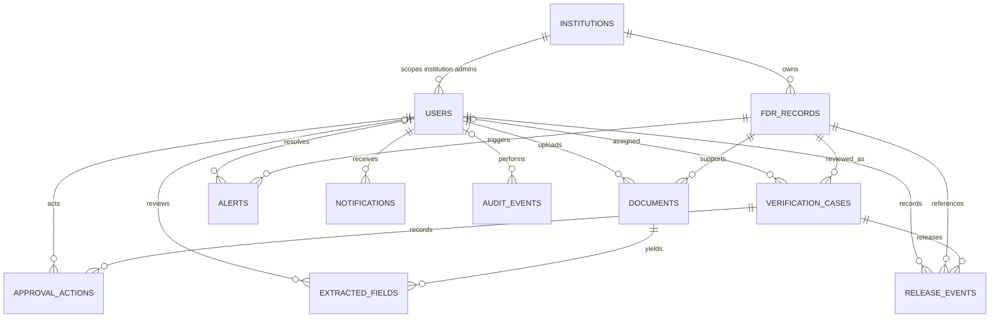

# Phase 2 database schema

The schema is a PostgreSQL-backed modular monolith. All primary keys are UUIDs. Created/updated timestamps use timezone-aware PostgreSQL timestamps. Monetary values use `NUMERIC(14,2)`. Alembic is the schema source of truth; application startup does not create or alter tables.

## Entity relationships



`notifications.related_record_id` and `audit_events.entity_id` are UUID references without a foreign key because those fields can refer to multiple entity kinds. `audit_events.entity_type` identifies the target kind. Integration synchronization runs are standalone source-import summaries.

## Constraints and value sets

Role and status value sets live in `backend/app/models/enums.py`. Models persist them as strings guarded by named `CHECK` constraints. This keeps values inspectable in SQL while rejecting invalid states at the database boundary.

- User roles: `system_admin`, `institution_admin`, `verification_officer`, `accounts_officer`, `final_approver`, `read_only_auditor`.
- Workflow states: `draft`, `submitted`, `under_review`, `more_information_required`, `rejected`, `verified`, `pending_approval`, `approved`, `release_pending`, `released`.
- FDR amount must be greater than zero; maturity date must be after issue date.
- `internal_fdr_id`, institution code, user email, and document storage key are unique.
- `fdr_number` is deliberately **not unique**. Non-unique indexes support lookups and duplicate detection, including within an institution.
- `(source_system, external_record_id)` is unique only when the external ID is non-null.
- Confidence is nullable; when present it must be between 0 and 1.
- Only one `open` or `acknowledged` alert per FDR and alert type can exist. Resolved or superseded history remains permitted.
- `approval_actions` and `audit_events` reject database `UPDATE` and `DELETE` through PostgreSQL triggers.
- A release event is a distinct record. An `approved` case alone does not represent a release.

## Indexes

Indexes cover institution references, FDR number and `(institution_id, fdr_number)`, maturity date, record and verification statuses, case status, alert status, audit entity and timestamp, and common child-table foreign keys. The external identifier and active-alert indexes are partial unique indexes.

## Deletion and retention

All declared foreign keys use `ON DELETE RESTRICT`; business and audit rows cannot be removed through cascading deletes. There is no automatic retention or cleanup job in this phase. Any production retention schedule must be set by the authorised organisation's policy. Audit history is append-only. The test fixture resets only its separate `*_test` database.

## Migration commands

From `backend/`:

```powershell
python -m alembic upgrade head
python -m alembic current
python -m alembic downgrade base
python -m alembic upgrade head
```

The downgrade command removes the Phase 2 schema and its data from whichever database `DATABASE_URL` names. Use it only for local disposable data. Tests perform this round-trip against `TEST_DATABASE_URL`.
