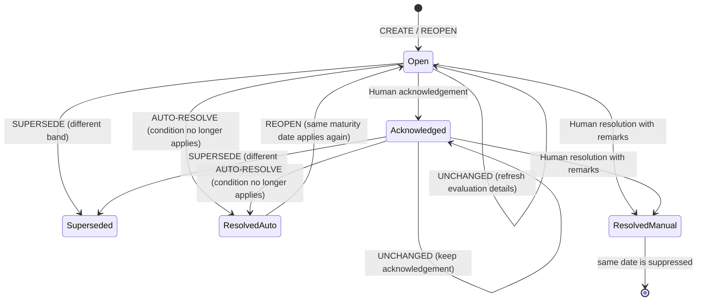

# Phase 6: Maturity Monitoring and Alert Generation

Phase 6 adds a persistent, rules-based maturity monitor, a scoped Alert Centre, and an optional daily scheduler. All development records and alerts are synthetic. The application has no connection to AICTE production systems or real FDR data.

## Demo maturity defaults

These are **demo defaults, not verified AICTE policy**. A System Administrator can configure the complete active rule set through the monitoring API.

| Days to stored maturity date | Label | Alert severity |
| --- | --- | --- |
| Less than 0 | Overdue-date review | High |
| 0–7 | Urgent | High |
| 8–30 | Attention required | Medium |
| 31–90 | Upcoming | Low |
| 91 or more | Normal (no alert) | Low |

An overdue date prompts a review of the stored date. It does not establish that an instrument is invalid, expired, or fraudulent.

## Evaluation and alert lifecycle

The engine evaluates `active`, `under_verification`, and `discrepancy` records. `matured` and `closed` records are excluded and their open engine-owned alerts are automatically resolved. A maturity date in the normal band also resolves any open engine-owned maturity alert.



- **CREATE:** Create an open alert with a neutral explanation and a snapshot of maturity date, reference date, thresholds, remaining days, and evaluation time. Do not recreate an alert manually resolved for the same maturity-date snapshot.
- **UNCHANGED:** Keep the band and status, refresh evaluation time/details, and preserve acknowledgement.
- **SUPERSEDE:** Mark the previous active band `superseded`, then create the new band alert.
- **AUTO-RESOLVE:** Resolve an open alert as `auto` when its band no longer applies, its date enters the normal band, or the record becomes matured/closed.
- **REOPEN:** Reopen an auto-resolved alert if its condition applies again for the same maturity date. A manually resolved alert remains suppressed for that date; editing the maturity date starts a new snapshot.

The engine owns only alerts with `source=system_rule` and one of its maturity alert types. Of the seven Phase 2 seed alerts, the active `maturity_upcoming` row is adopted as an owned rule alert so it can be reconciled without duplication. The other six rows are retained as `legacy_seed`; the engine does not change them. No seed rows are deleted.

## Timezone and scheduling

`APP_TIMEZONE` defaults to `Asia/Kolkata`. “Today” is derived from the current instant in this configured IANA timezone, not UTC or the host's local timezone. Tests can pass an explicit reference datetime to the evaluation service.

The in-process APScheduler is disabled by default (`SCHEDULER_ENABLED=false`) and tests force it off. When enabled it registers one daily cron job at `MONITORING_RUN_HOUR` and `MONITORING_RUN_MINUTE` (defaults `2` and `0`) in `APP_TIMEZONE`. It uses one instance, coalesces missed occurrences, and allows a one-hour misfire grace period. The PostgreSQL transaction advisory lock serializes workers; a concurrent invocation records `skipped_locked` and exits without evaluating records. This also protects against duplicate workers and development reload restarts.

Run once from `backend/` without the API:

```powershell
python -m app.services.monitoring run
python -m app.services.monitoring run --reference-date 2026-10-27
```

Each run writes one `monitoring_job_runs` row and one summary audit event with counts. Per-record failures are isolated and recorded by record ID and exception type, without exception messages or traceback data.

## API

All routes are under `/api/v1`.

| Method and path | Permission | Purpose |
| --- | --- | --- |
| `GET /alerts` | `alert.read` | Filtered, paginated, sortable alerts; institution-scoped for institution administrators |
| `GET /alerts/{id}` | `alert.read` | Alert, safe details, FDR summary, lifecycle history |
| `POST /alerts/{id}/acknowledge` | `alert.manage` | Acknowledge an open alert; repeat acknowledgement is safe |
| `POST /alerts/{id}/resolve` | `alert.manage` | Manually resolve open/acknowledged alert with required remarks |
| `GET /monitoring/summary` | `alert.read` | Counts by band/severity/status, upcoming records by band, last run |
| `GET /monitoring/rules` | `alert.read` | Current rules and demo-default notice |
| `PUT /monitoring/rules` | `monitoring.configure` | Validate and audit a complete rule-set update |
| `GET /monitoring/runs` | `monitoring.run` | Paginated run history |
| `POST /monitoring/run` | `monitoring.run` | Start an audited manual run; reference date cannot exceed 366 days ahead |

There are no delete endpoints for alerts, rules, or run history. Alert details expose only an allowlisted subset of JSON details; operational exceptions, internal database fields, and stack traces are not returned. Institution administrators requesting an alert outside their institution receive 404.

## Permission changes

| Role | Monitoring permissions |
| --- | --- |
| System Administrator | `alert.read`, `alert.manage`, `monitoring.run`, `monitoring.configure` |
| Institution Administrator | `alert.read` for own institution only |
| Verification Officer | `alert.read`, `alert.manage` |
| Accounts Officer | `alert.read` |
| Final Approver | `alert.read` |
| Read-only Auditor | `alert.read` |

This is a proposed application permission design, not a verified AICTE organisation model. The backend enforces it; frontend visibility is only a usability feature.

## Limitations

- Thresholds are configurable demonstration defaults, not an AICTE-approved policy.
- Alerts describe stored record data and do not verify a bank, instrument, or legal/financial status.
- The scheduler is in-process and runs only while its API process is alive. Deployments with multiple workers rely on the database advisory lock for serialization.
- Notifications/email, document processing, discrepancy rules, priority scoring, and workflow transitions remain out of scope for this phase.
- Rule changes are audited, but historical alert snapshots remain as originally evaluated.
