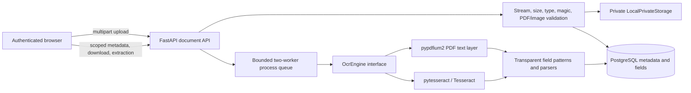
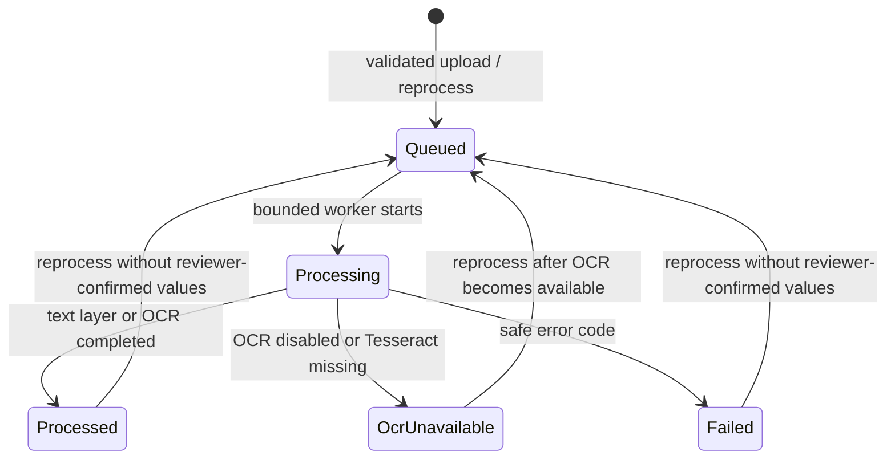

# Phase 7: Secure Document Upload and OCR-Assisted Extraction

Phase 7 adds private document uploads, metadata and lifecycle APIs, background extraction, and read-only extracted/stored value comparison on an FDR detail page. All demo data is synthetic. This phase does not implement human correction, verification, discrepancy rules, alerts, cases, priority scoring, notifications, or antivirus scanning.

## Architecture

## Private storage and validation

Files live under `STORAGE_ROOT` (default `backend/storage`), outside any static web mount. Set this to a local directory outside OneDrive on this OneDrive-synced project. Storage keys are server-generated UUID paths sharded by their first two byte pairs; they are neither API fields nor logged. Path resolution validates the key format and confirms the resolved path remains inside the root. Files are streamed to a temporary file, validated, hashed, then atomically moved. Directory/file permissions are restricted where the operating system supports them. There is no delete route; uploaded documents are retained.

| Input | Server checks | Safe failure |
| --- | --- | --- |
| PDF | `.pdf`, `application/pdf`, `%PDF-` signature, parseable and unencrypted, page cap | 415 unsupported/type mismatch or 422 unreadable/page limit |
| PNG | `.png`, `image/png`, PNG signature, Pillow decode, 40-megapixel safety cap | 415 unsupported/type mismatch or 422 unreadable/pixel limit |
| JPEG | `.jpg`/`.jpeg`, `image/jpeg`, JPEG signature, Pillow decode, pixel cap | 415 unsupported/type mismatch or 422 unreadable/pixel limit |
| All uploads | non-empty, chunk-streamed maximum size, SHA-256, exact per-FDR duplicate check, per-FDR count | 413 size limit, 422 empty file, 409 duplicate or document cap |

Client filenames are sanitized for display only and never form a filesystem path. Extension, declared media type, and magic bytes must agree. Scripts or executables renamed to a supported extension are rejected. Uploaded content is never executed. There is **no antivirus or malware scanning** in this prototype; production deployment needs an appropriate scanning and quarantine service before files are trusted or served.

## Configuration

| Setting | Default | Purpose |
| --- | --- | --- |
| `STORAGE_ROOT` | `backend/storage` | Private local file root; created and write-checked at application startup |
| `MAX_UPLOAD_MB` | `10` | Streaming upload limit |
| `MAX_PDF_PAGES` | `10` | PDF page limit |
| `MAX_DOCUMENTS_PER_FDR` | `20` | Per-record document cap |
| `OCR_ENABLED` | `true` | Enables Tesseract fallback |
| `TESSERACT_CMD` | unset | Optional Tesseract executable path |
| `OCR_LANGUAGES` | `eng` | Tesseract language codes |
| `OCR_TIMEOUT_SECONDS` | `60` | Timeout passed to Tesseract calls |
| `PROCESSING_STALE_MINUTES` | `15` | Age used for stale-processing startup count |

Tesseract is installed in the evaluated Windows environment at `C:\Program Files\Tesseract-OCR\tesseract.exe` (Tesseract 5.4.0.20240606; available languages `eng` and `osd`). Backend configuration now loads `backend/.env` before the repository-level `.env`, while existing process environment values retain precedence. On Windows install Tesseract with `winget install --id UB-Mannheim.TesseractOCR -e`. PaddleOCR is deferred: it adds a much larger Windows runtime and model-install footprint, and the lighter Tesseract path is evaluated first. `pytesseract` is only a Python bridge and does not bundle the Tesseract executable.

## Processing lifecycle and recovery

The process-local `ThreadPoolExecutor` runs at most two jobs concurrently and holds at most twenty additional queued jobs. The upload response is `202 Accepted` with `queued`; workers persist status transitions. A startup log reports how many `processing` rows exceed `PROCESSING_STALE_MINUTES`. Those rows can be re-queued through the verification-only reprocess endpoint. This queue is process-local and not durable across a crash; stale rows require manual reprocess. A production multi-worker deployment should use a durable queue.

PDFs use an embedded text layer first. Scanned PDFs render within the page cap and go to Tesseract; PNG/JPEG images go directly to Tesseract. OCR is behind the `OcrEngine` protocol. Tesseract receives a timeout. Full OCR text is held in memory only: it is not persisted, included in audit events, or logged. Failure metadata uses short safe codes such as `unreadable_pdf`, `ocr_timeout`, and `ocr_error`, never raw exception text or paths. When OCR is unavailable, upload remains successful, status is `ocr_unavailable`, and configured field rows are retained as null values.

## Extraction rules and confidence

Configured fields are `fdr_number`, `bank_name`, `branch_name`, `amount`, `interest_rate`, `issue_date`, and `maturity_date`. Case-insensitive keyword patterns locate labels such as “FDR Number,” “Bank Name,” “Principal Amount,” “Interest Rate,” “Issue Date,” and “Maturity Date.” Tolerant parsers normalize Indian comma-grouped amounts and rupee/INR prefixes, decimal interest rates, and dates in `DD/MM/YYYY`, `DD-MM-YYYY`, `DD Mon YYYY`, `DD Month YYYY`, and ISO forms. Captured field text is stored as extracted; normalized forms are used only for informational comparisons. A row exists for every configured field, including missing values.

Text-layer values have null confidence because no OCR confidence exists. Tesseract confidence, when word-level data is available, is averaged over recognized tokens in the matched value and stored on a 0–1 scale. It is Tesseract's own recognition score, **not a probability that the value is correct**. Null is displayed as “not available”; no confidence is invented for missing or text-layer values.

The extraction API compares machine-extracted text with stored FDR values using tolerant parsers. Results are informational (`matches`, `differs`, `not_comparable`, `not_extracted`) and labelled “Machine-extracted and unreviewed. OCR output does not confirm that a document is genuine.” No comparison creates an alert, case, verification result, or workflow action.

## Synthetic fixture evaluation

From `backend/`, run `python -m scripts.generate_ocr_fixtures` and `python -m scripts.evaluate_ocr_fixtures`. Files are generated in gitignored private storage and not committed. They use fictional institutions/banks and seeded synthetic FDR values only. This evaluation says nothing about OCR accuracy on real bank documents.

Observed after regenerating fixtures in this environment (`pypdfium2 5.14.0`; Tesseract 5.4.0.20240606). Confidence values below are Tesseract word-data averages; they are recognition scores, not probabilities. `NULL` means the method has no OCR word confidence or no candidate was extracted.

| Fixture | Method | fdr_number | bank_name | branch_name | amount | interest_rate | issue_date | maturity_date |
| --- | --- | --- | --- | --- | --- | --- | --- | --- |
| `text_layer.pdf` | PDF text layer | `SYNTH-FDR-0001` (match; conf. NULL) | `Synthetic Community Bank 01` (match; NULL) | `Synthetic Branch 001` (match; NULL) | `INR 235,357.00` (match; NULL) | not extracted (NULL) | `05 Mar 2024` (match; NULL) | `24 Oct 2027` (match; NULL) |
| `image_only.pdf` | Tesseract OCR | `SYNTH-FDR-0005` (match; 0.820) | `Synthetic Community Bank 05` (match; 0.954) | `Synthetic Branch 005` (match; 0.940) | `INR 3,345,652.00` (differs; 0.865) | not extracted (NULL) | `30 Jul 2024` (match; 0.957) | `23 Dec 2026` (match; 0.957) |
| `clean.png` | Tesseract OCR | `SYNTH-FDR-0001` (match; 0.910) | `Synthetic Community Bank 01` (match; 0.958) | `Synthetic Branch 001` (match; 0.960) | `INR 235,357.00` (match; 0.960) | not extracted (NULL) | `05 Mar 2024` (match; 0.953) | `24 Oct 2027` (match; 0.953) |
| `noisy.jpg` | Tesseract OCR | not extracted (NULL) | not extracted (NULL) | not extracted (NULL) | not extracted (NULL) | not extracted (NULL) | not extracted (NULL) | not extracted (NULL) |
| `blank.png` | Tesseract OCR | not extracted (NULL) | not extracted (NULL) | not extracted (NULL) | not extracted (NULL) | not extracted (NULL) | not extracted (NULL) | not extracted (NULL) |

The noisy JPEG yielded no configured fields, rather than silently returning confident incorrect values. In the separate real-engine smoke test's noisy sample, the fields that did extract were either low confidence (FDR number 0.500) or matched their synthetic values; the test asserts that high-confidence values match. The text-layer PDF values all have NULL confidence because they came from embedded text, not Tesseract. Four Tesseract-dependent backend tests, previously skipped when the app failed to load `backend/.env`, now ran successfully. These fixtures are synthetic-only and say nothing about OCR performance on real bank documents.

## Permissions and API

| Method and path | Permission | Purpose |
| --- | --- | --- |
| `POST /api/v1/fdrs/{fdr_id}/documents` | `document.upload` | Validated multipart upload; institution administrators upload only to their own FDRs |
| `GET /api/v1/fdrs/{fdr_id}/documents` | `document.read` | Scoped document list |
| `GET /api/v1/documents/{id}` | `document.read` | Safe metadata and processing status/error code |
| `GET /api/v1/documents/{id}/download` | `document.read` | Audited private attachment stream with safe content type, no-store, and nosniff headers |
| `GET /api/v1/documents/{id}/extraction` | `document.read` | Read-only extracted fields and stored-value comparison |
| `POST /api/v1/documents/{id}/reprocess` | `document.reprocess` | Queue extraction only if no reviewer-confirmed value exists |

Document readers are Institution Administrators (own institution only), Verification Officers, Final Approvers, and Read-only Auditors. `document.upload` is Institution Administrator-only. `document.reprocess` is Verification Officer-only. System Administrators receive no document permission. Cross-institution documents return 404. No document DELETE route exists. Responses never include storage keys or filesystem paths. Upload, download, and reprocess are audited with IDs/type/size/checksum/status only; no file text or contents are included.

## Limitations

- Tesseract must be installed separately; Python dependencies alone do not provide the executable.
- The in-process queue is bounded but not durable across a crash. Stale processing is logged and can be manually re-queued.
- No antivirus scanning, human corrections, verification, discrepancy detection, alerts/cases, priority scoring, document deletion, or production data integration is included.
- Synthetic fixture results do not measure real-document OCR performance. OCR output is unreviewed machine extraction, not proof of authenticity.
